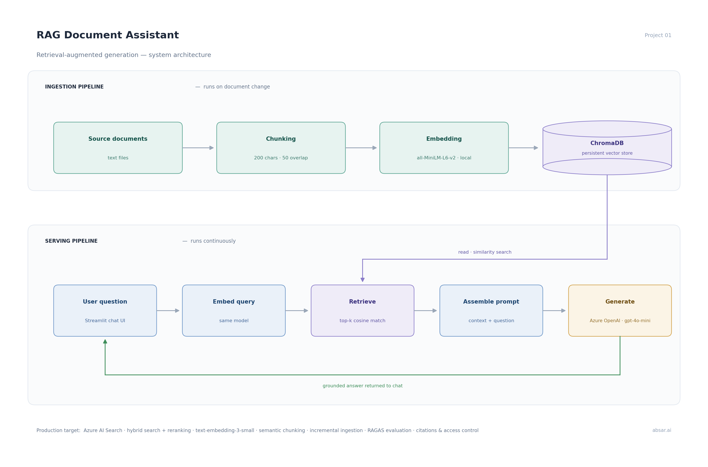
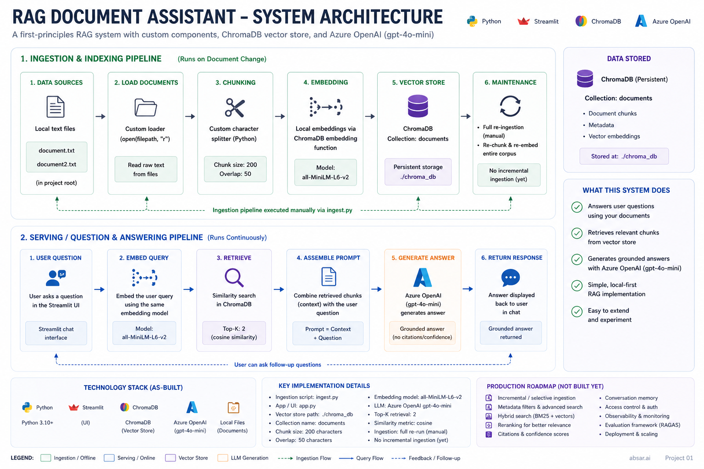

# RAG Document Assistant

A retrieval-augmented generation (RAG) system built from first principles - a document question-answering assistant that retrieves relevant context from a knowledge base and generates grounded answers using Azure OpenAI.

This project was built component by component to understand the mechanics of RAG end to end, rather than relying on a framework that hides the moving parts. Every stage - chunking, embedding, vector storage, retrieval, and grounded generation, is implemented explicitly.

## What it does

Ask a question in a chat interface; the system retrieves the most relevant passages from its ingested documents and answers using only that context. If the answer isn't in the documents, it says so rather than inventing one.

## Architecture



The system separates into two independent pipelines that communicate only through the vector store.

**Ingestion pipeline** (`ingest.py`) - runs when documents change:
1. Load source documents
2. Chunk into overlapping segments (200 characters, 50-character overlap)
3. Embed each chunk into a vector (all-MiniLM-L6-v2, running locally)
4. Store vectors in a persistent ChromaDB collection on disk

**Serving pipeline** (`app.py`) - runs continuously:
1. Accept a user question via a Streamlit chat interface
2. Embed the question with the same model used at ingestion
3. Search the vector store for the most similar chunks (cosine similarity)
4. Assemble a prompt: system instruction + retrieved context + question
5. Generate a grounded answer with Azure OpenAI (gpt-4o-mini)

Separating ingestion from serving is deliberate: the two have different lifecycles. Ingestion is expensive and runs only when source content changes; serving is lightweight and runs on every query. They never call each other — they share state through the vector store alone. 

### Detailed system overview



## Tech stack

- **LLM:** Azure OpenAI (gpt-4o-mini)
- **Embeddings:** all-MiniLM-L6-v2 (local, via ChromaDB default)
- **Vector store:** ChromaDB (persistent, local disk)
- **Interface:** Streamlit
- **Language:** Python

## Running it

1. Clone the repo and create a virtual environment:
   ```
   python -m venv .venv
   .venv\Scripts\Activate.ps1
   ```
2. Install dependencies:
   ```
   pip install -r requirements.txt
   ```
3. Copy `.env.example` to `.env` and add your Azure OpenAI credentials.
4. Ingest the documents (run once, and again whenever documents change):
   ```
   python ingest.py
   ```
5. Launch the chat interface:
   ```
   python -m streamlit run app.py
   ```

## Production considerations

This is a fundamentals build. A production deployment in a regulated enterprise environment would extend it as follows:

- **Vector store:** replace local ChromaDB with a managed service such as Azure AI Search for scale, availability, and access control.
- **Embeddings:** move from the local model to Azure text-embedding-3-small for higher-quality vectors and managed hosting.
- **Retrieval:** add hybrid search (semantic + keyword) to handle exact-match terms like reference numbers and case IDs, plus a reranking pass to improve relevance ordering.
- **Chunking:** chunk on sentence or semantic boundaries rather than fixed character counts, to avoid splitting meaning mid-sentence.
- **Ingestion:** make ingestion incremental — process only new or changed documents — triggered on a schedule or by document events rather than run manually.
- **Evaluation:** wire in RAGAS metrics (context precision, context recall, faithfulness, answer relevance) to measure retrieval and answer quality objectively.
- **Governance:** add response citations, document-level access control, observability, cost monitoring, and guardrails — essential in regulated settings.

## Notes

Built as part of a hands-on AI architecture portfolio. The goal was depth of understanding: being able to design, defend, and extend a RAG system, not just call a library.
